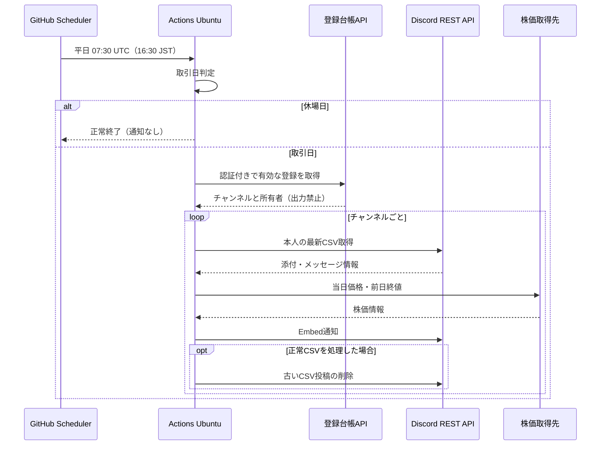

# 本番運用 — GitHub Actions

[← Home](Home.md) ｜ [ロードマップ](Implementation-Roadmap.md)

> **状態：予定。Actionsワークフローは未実装。** 料金・無料枠・権限・サービス制約はデプロイ前に最新の公式情報で検証します。

## 運用方針

- 個人アカウントの**公開リポジトリ** `chihiros7/stock-signal` を使用し、会社のOrganizationは使いません。
- サーバーは借りず、Actions実行中だけPythonバッチからDiscord REST APIへアクセスします。
- `runs-on: ubuntu-latest` を使用します。
- 平日16:30 JST（UTC 07:30）を目安に実行し、手動起動 `workflow_dispatch` も提供します。
- GitHub Actionsのcronは遅延する可能性があり、厳密な16:30到着は保証しません。
- 日本の祝日だけでなく、**東証の実際の休場日**を考慮する仕組みが必要です。休日判定ライブラリは未決。

## 登録受付の構成変更

利用者自身の `/登録` を初期リリースに追加します。即時応答受付と非公開登録台帳（Workers + D1候補）を別途用意し、日次Actionsは認証付きの読み取り専用APIから有効な登録を取得します。`CHANNEL_OWNERS` の手動更新は廃止する設計です。受付・台帳を先にテストし、利用者追加時のGitHub設定変更を不要にします。料金・カード要否・実装方式は導入前に検証します。詳細は [登録設計](Registration-Design.md) を参照してください。

## スケジュール構成



## ワークフローの設定案（未実装）

```yaml
name: Daily portfolio notification
on:
  schedule:
    - cron: "30 7 * * 1-5"
  workflow_dispatch:
jobs:
  notify:
    runs-on: ubuntu-latest
    steps:
      - uses: actions/checkout@<検証したバージョン>
      - uses: actions/setup-python@<検証したバージョン>
      # Python依存関係をインストール
      # Secretsを環境変数で渡してアプリを実行
```

上記は**設計例**であり、`<検証したバージョン>` はプレースホルダーです。このまま動作するワークフローではありません。checkout/setup-pythonの採用バージョンは実装時に公式情報を確認します。

## 無料運用の検証項目

| 項目 | 設計メモの想定 | 状態 |
| --- | --- | --- |
| 公開リポジトリの標準GitHubホステッドランナー | 標準ランナーの実行は無料。非公開用の月2,000分という想定は適用しない | **公式確認済み**。大型ランナーは対象外 |
| 有料機能・ストレージ | 大型ランナーや成果物・キャッシュ等の料金条件は別に確認 | **導入前に要確認** |
| 実行時間 | 1回約1分、月約30分の見込み | **計測前の概算** |
| 定期実行の停止 | 公開リポジトリで60日間活動がないとスケジュール実行が自動無効化される | **公式確認済み**。運用で状態確認と再有効化の手順を用意 |
| 実行遅延 | 数分〜十数分の遅れを許容 | **実測前** |

**「無料で運用できる」「請求されない」と保証するものではありません。** 最新の請求設定、利用枠、対象ランナー、停止条件を確認してから有効化します。

公式情報：[Actionsの料金](https://docs.github.com/en/billing/concepts/product-billing/github-actions)、[scheduleイベント](https://docs.github.com/en/actions/reference/workflows-and-actions/events-that-trigger-workflows#schedule)。

## 運用上の失敗対策（実装時に決定）

- APIのレート制限・ネットワーク障害は安全に再試行し、チャンネルごとに失敗を分離。
- 通知の二重投稿防止（Actions再実行時）と、CSV削除前の成功確認。
- トークン漏洩時の失効・再発行、権限喪失時の管理者への通知（初期導入は未決）。
- Actionsログには秘密情報・保有情報を出さない。
- 手動実行を先にテストし、動作確認後に定期実行を有効化する。
