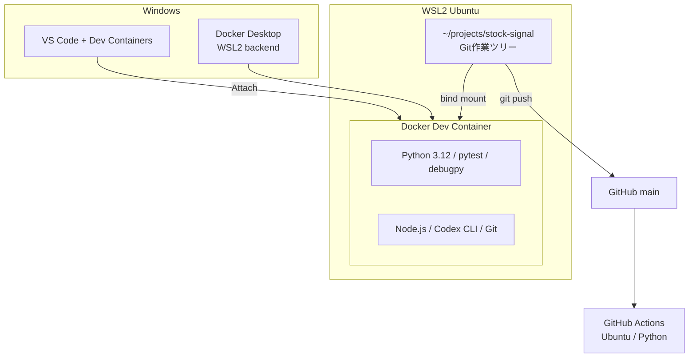
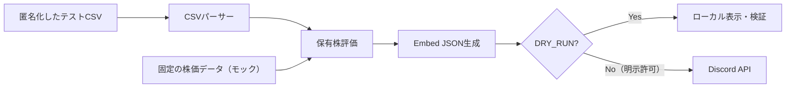

# 開発環境 — WSL2 / Docker / Codex

[← Home](Home.md) ｜ [ロードマップ](Implementation-Roadmap.md)

> **状態：提案構成。まだファイルの実装・動作確認は行っていません。**

## 目標

Windows上のWSL2 Ubuntuにリポジトリを配置し、Docker Dev Containerの中でPython・pytest・debugpy・Codex CLIを使います。VS Codeからコンテナへ接続してブレークポイントでデバッグします。本番GitHub Actionsはコンテナを常駐させず、UbuntuランナーでPythonを直接実行します。

## 初期セットアップ

1. Windows PowerShell（管理者）で `wsl --install -d Ubuntu` を実行し、`wsl -l -v` でWSL2を確認。
2. Docker Desktopを導入し、WSL2エンジンとUbuntuへのWSL Integrationを有効化。
3. Ubuntu内で `docker run --rm hello-world` を確認。
4. Ubuntuのホーム配下に `~/projects/stock-signal` をclone（`/mnt/c` 配下を避ける）。
5. VS CodeにWSL、Dev Containers、Python、Python Debugger拡張を導入。
6. `.devcontainer/Dockerfile` と `devcontainer.json` を実装後、VS Codeの **Dev Containers: Reopen in Container** を実行。
7. コンテナ内で `python --version`、`codex --version`、`pytest` を確認。

## コンテナ仕様（実装案）

| 項目 | 方針 |
| --- | --- |
| ベース | Microsoft Dev Containers Python 3.12（Debian系） |
| 追加ツール | Node.js LTS、Codex CLI、Git、pytest、debugpy |
| ワークスペース | WSL内のGit作業ツリーをbind mount |
| Pythonデバッグ | VS Codeの `launch.json` で `debugpy` を使用 |
| 認証 | Codexログインをコンテナ内で実行。認証情報はGitへ追加しない |
| 環境変数 | `.env` はgitignore対象、`.env.example` にダミーキーだけ記載 |
| 動作モード | 初期は `DRY_RUN=true` で外部送信・削除を抑止 |

## デバッグの流れ

- 単体テストでは外部ネットワークを使わず、CSV・株価・Discordレスポンスをモックします。
- 統合テストでは専用テストチャンネルを使用します。実際の保有データをテスト用Git履歴に残しません。
- **古いCSV削除は最後に有効化**し、まずは削除候補をログに個人情報なしで記録するだけにします。
- Codex認証の永続化は安全なボリューム等で別途設計し、トークンをDockerfile・イメージに含めません。

## 本番との違い

| 開発 | 本番 |
| --- | --- |
| WSL2 + Dockerコンテナ | GitHub Actions ubuntu-latest |
| Codexで実装・VS Codeでデバッグ | Codex不要、Pythonのみ実行 |
| DRY_RUN / モック / テストチャンネル | Secretsを使用し実チャンネルへ通知 |
| 手動実行・pytest | 平日スケジュール・workflow_dispatch |

**未決：** Pythonの最終バージョン、依存パッケージの固定方式、コンテナの認証永続化、Discordテスト用Bot・チャンネルの用意。
