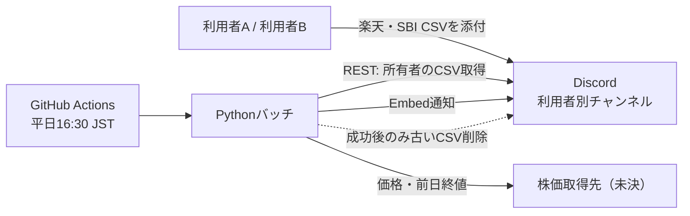

# stock-signal — 持ち株通知Bot

> **状態：設計段階（コード未実装）**  
> 本ドキュメントは2026-11-14時点で提示された設計メモを整理したものです。無料枠、サービス仕様、API制約は実装前に公式情報で再確認します。

## 目的

複数利用者の保有株式を、**利用者ごとの非公開Discordチャンネル**へ平日の取引終了後に通知します。利用者は楽天証券またはSBI証券からダウンロードしたCSVを自分のチャンネルへ添付して保有情報を更新します。

**基本原則**
- GitHubリポジトリとWikiは公開する。個人情報・認証情報・保有資産情報を一切反映せず、誤反映やその疑いを検知したら直ちに報告する。詳細はリポジトリ直下の `AGENTS.md` に従う。
- サーバーを常駐させない。GitHub ActionsからDiscord REST APIを呼び出す。
- クレジットカード登録なし・継続費用ゼロを目標にする（達成可否は最新条件で要確認）。
- CSVや保有資産情報をGitHubにコミットしない。ログにも出さない。
- 各チャンネルの閲覧範囲は利用者本人が設定する。ただし管理者とDiscord事業者によるアクセスの制約は明示する。
- 最初はCSV添付と日次通知に絞り、対話的な編集コマンドは第2段階にする。

## システム概要

## Wiki目次

| ページ | 内容 |
| --- | --- |
| [System-Architecture](System-Architecture.md) | システム構成・責務・データ境界 |
| [Development-Environment](Development-Environment.md) | WSL2 / Ubuntu / Docker / Codex / VS Code |
| [Processing-Flow](Processing-Flow.md) | CSV検証、計算、通知、削除の処理フロー |
| [Security-Design](Security-Design.md) | Discord権限、Secrets、個人情報 |
| [Deployment](Deployment.md) | GitHub Actionsの実行設計と運用 |
| [Implementation-Roadmap](Implementation-Roadmap.md) | 実装段階、未決事項、将来機能 |

## 決定済みと未決の区別

**決定済み：** Discordのチャンネル単位で管理／平日16:30 JSTにActionsで実行／Discord REST API／成功時だけ旧CSVを削除／通知履歴を保持／利用者本人のCSVのみを受理。

**未決・要検証：** 楽天・SBIのCSV実形式、日本株以外の扱い、個人情報の含有、株価API、Discord権限の実効性、Actionsの現行無料枠・スケジュール停止条件。

> **注意：** GitHub Actions Secretsには認証情報とチャンネルID・所有者IDの対応表を置きます。CSV本体は置きません。
