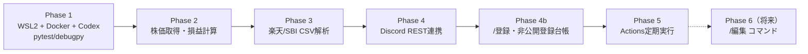
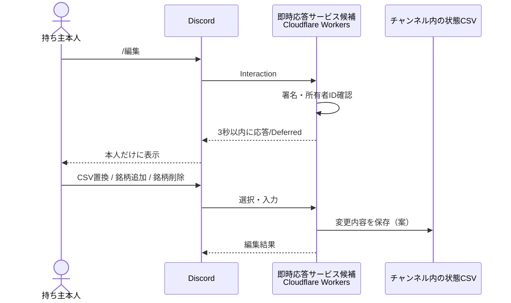

# 実装ロードマップと未決事項

[← Home](Home.md) ｜ [開発環境](Development-Environment.md)

## 段階的な開発計画

自動テスト・CI/CDは [Testing-and-CI](Testing-and-CI.md) に沿って各Phaseで整備する。CIを早期に導入し、本番の定期バッチ・デプロイは後半で別ワークフローとして追加する。

### 現在の進捗

- Phase 1：開発コンテナでPython 3.12・Codex・debugpy・pytestを確認済み。VS Code上のブレークポイント停止は手動確認が残る。
- CI：Ruff、書式検査、ネットワーク禁止のpytestを実装。mainへのpush・PR・手動実行で検証する。本番の送信・削除・デプロイは行わない。
- Phase 2：開発検証完了。円建て評価計算、XTKS取引日判定、開発用株価取得、基準日以降の分割・欠損・通貨・時刻の検証を実装し、公開銘柄の実データでも計算を確認。本番向けデータ利用条件と取得元の採用は保留（[株価取得設計](Market-Data.md)）。
- Phase 3以降：未実装。原本CSVはローカルの `tmp/` のみで扱い、実保有情報をGitへ転記しない。

| Phase | 目標 | 完了条件 |
| --- | --- | --- |
| 1 | WSL2 Ubuntu、Docker Dev Container、Codex、VS Codeデバッグ・CI | コンテナ起動・Codex認証・pytest・ブレークポイント動作・CI成功 |
| 2 | 日本株の株価・前日終値取得、評価計算 | モックと実データで計算を検証、失敗時も誤表示しない |
| 3 | 楽天・SBIのCSV解析 | **匿名化した実CSV**を基に文字コード・口座区分・例外をテスト |
| 4 | Discordチャンネル連携 | 本人ID照合、通知、エラー処理、削除候補の安全確認 |
| 4b | 利用者自身の `/登録` | 非公開チャンネル・権限・台帳の自動設定、重複防止、障害復旧、無料条件の確認 |
| 5 | GitHub Actions本番化 | 手動実行・休場日判定・Secrets・定期実行・無料枠確認 |
| 6（第2段階） | `/編集` コマンド | 本人だけ編集可能、3秒以内の初期応答、状態の永続化 |

## 未決事項・検証リスト（元設計メモに準拠）

| # | 論点 | 状態・次のアクション |
| --- | --- | --- |
| 1 | 楽天証券・SBI証券の実CSV（列・前置行・文字コード・ダウンロード画面） | 楽天の保有商品一覧はローカルで構造確認済み（CP932、CRLF、前置行＋18列明細）。実保有情報は転記せず、架空fixtureで解析を実装する。SBIは未入手 |
| 2 | 日本株以外（米国株・投信・債券）の扱い | **未決**。除外して件数表示／米国株円換算／投信対応から選択 |
| 3 | CSVに氏名・口座番号が含まれるか | **未確認**。含む場合は最小化CSVへの置換を検討 |
| 4 | 株価取得元 | yfinanceを開発検証用に実装。複数利用者への本番提供条件は要確認。J-Quants無料は12週間遅延のため当日通知に不適合（[詳細](Market-Data.md)） |
| 5 | 持ち主がBotの権限を外せるか | **要検証**。Discordの実権限でテスト |
| 6 | 公開リポジトリのActions定期実行停止への対応 | 60日間活動がないとスケジュール実行が自動無効化される。状態確認・再有効化の運用手順を用意（[公式仕様](https://docs.github.com/en/actions/reference/workflows-and-actions/events-that-trigger-workflows#schedule)） |
| 7 | actions/checkout・actions/setup-pythonのバージョン | **実装時に公式確認** |

### 追加で実装時に確定すること

- 不正な最新CSVがある場合、前回正常CSVをどう探して使うか。
- 正常なCSVの削除タイミング、通知の二重投稿・再実行対策。
- 東証の休場日判定（日本の祝日だけでは不足する可能性）。
- CSVの保有基準日を確認し、基準日以降の分割・併合を検証する。基準日不明・古いCSVの更新確認はPhase 3で扱う。
- Embedの文字数上限・分割・取得不能銘柄・ゼロ損益の表示。
- Dev Containerの認証情報永続化と依存パッケージの固定。

## 初期リリース：`/登録` コマンド

利用者自身の `/登録` を採用します。即時応答受付と非公開登録台帳を前倒しで追加し、従来のDBなし・所有者対応表のSecrets手動更新という方針を見直します。Cloudflare Workers + D1は候補です。料金・カード要否・動作検証を行って採否を確定します。詳細は [登録設計](Registration-Design.md) を参照してください。

## 第2段階：`/編集` コマンド

- スラッシュコマンドは3秒以内に最初の応答が必要で、Deferred応答後のフォローアップは15分以内という想定。
- GitHub Actionsだけでは即時応答できないため、**Cloudflare Workersが候補**。無料枠・カード要否・Python対応の制約は要確認。
- チャンネルと持ち主の対応は `/登録` と日次処理で同じ非公開台帳を参照し、別々の対応表を作らない。
- Bot自身がチャンネルへ最小CSVを再投稿する案を検討。保存形式と更新競合は未決。
- 編集操作は所有者本人のみ許可し、編集UIは本人にだけ見える応答を使う。

## 採用を見送った案

| 案 | 見送った理由 |
| --- | --- |
| Discord Webhookのみ | CSVの取得・履歴参照ができない |
| Render無料枠 | スリープ・永続性・定期実行の制約 |
| Google Cloud / Oracle Cloud | カード登録が必要という前提と合わない |
| Heroku / Fly.io / Railway | 無料継続運用の条件が目標に合わない |
| Firestore | 登録台帳以外の日次通知・保有資産保存用DBは不要 |
| CSVをGitHubに保存 | コミット履歴に個人情報が残る |
| CSVをGitHub Secretsに保存 | 本人が更新できず、リポジトリ権限のリスクが増える |
| Botへの共有コマンド | 反映遅延を避け、本人がDiscord権限で共有する方針 |
| 利用者ごとのGitHubコピー | 利用者全員にGitHub設定が必要 |

上記のサービス比較は**設計当時の判断**です。各社の最新料金・制限を再検証してから最終決定します。
