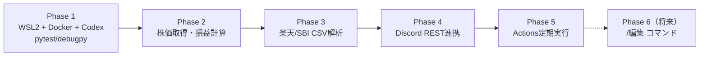
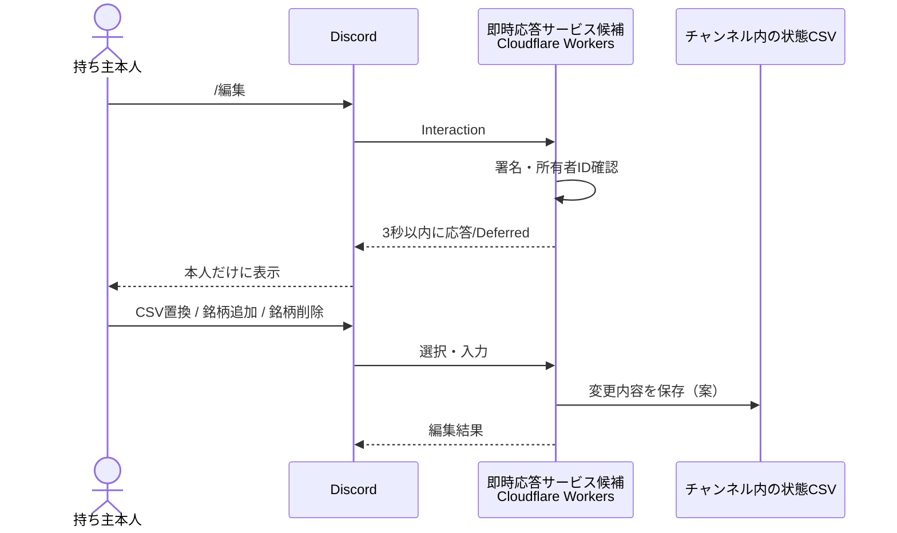

# 実装ロードマップと未決事項

[← Home](Home.md) ｜ [開発環境](Development-Environment.md)

## 段階的な開発計画

| Phase | 目標 | 完了条件 |
| --- | --- | --- |
| 1 | WSL2 Ubuntu、Docker Dev Container、Codex、VS Codeデバッグ | コンテナ起動・Codex認証・pytest・ブレークポイント動作 |
| 2 | 日本株の株価・前日終値取得、評価計算 | モックと実データで計算を検証、失敗時も誤表示しない |
| 3 | 楽天・SBIのCSV解析 | **匿名化した実CSV**を基に文字コード・口座区分・例外をテスト |
| 4 | Discordチャンネル連携 | 本人ID照合、通知、エラー処理、削除候補の安全確認 |
| 5 | GitHub Actions本番化 | 手動実行・休場日判定・Secrets・定期実行・無料枠確認 |
| 6（第2段階） | `/編集` コマンド | 本人だけ編集可能、3秒以内の初期応答、状態の永続化 |

## 未決事項・検証リスト（元設計メモに準拠）

| # | 論点 | 状態・次のアクション |
| --- | --- | --- |
| 1 | 楽天証券・SBI証券の実CSV（列・前置行・文字コード・ダウンロード画面） | **未入手**。個人情報・金額を架空値にしたサンプルを収集。Excelで開いて再保存しない |
| 2 | 日本株以外（米国株・投信・債券）の扱い | **未決**。除外して件数表示／米国株円換算／投信対応から選択 |
| 3 | CSVに氏名・口座番号が含まれるか | **未確認**。含む場合は最小化CSVへの置換を検討 |
| 4 | 株価取得元 | **未決**。yfinance案、J-Quantsの無料プラン・遅延・制約を調査 |
| 5 | 持ち主がBotの権限を外せるか | **要検証**。Discordの実権限でテスト |
| 6 | 公開リポジトリのActions定期実行停止への対応 | 60日間活動がないとスケジュール実行が自動無効化される。状態確認・再有効化の運用手順を用意（[公式仕様](https://docs.github.com/en/actions/reference/workflows-and-actions/events-that-trigger-workflows#schedule)） |
| 7 | actions/checkout・actions/setup-pythonのバージョン | **実装時に公式確認** |

### 追加で実装時に確定すること

- 不正な最新CSVがある場合、前回正常CSVをどう探して使うか。
- 正常なCSVの削除タイミング、通知の二重投稿・再実行対策。
- 東証の休場日判定（日本の祝日だけでは不足する可能性）。
- Embedの文字数上限・分割・取得不能銘柄・ゼロ損益の表示。
- Dev Containerの認証情報永続化と依存パッケージの固定。

## 第2段階：`/編集` コマンド

- スラッシュコマンドは3秒以内に最初の応答が必要で、Deferred応答後のフォローアップは15分以内という想定。
- GitHub Actionsだけでは即時応答できないため、**Cloudflare Workersが候補**。無料枠・カード要否・Python対応の制約は要確認。
- チャンネルと持ち主の対応表がGitHubとCloudflareの2か所に必要になる可能性がある。
- Bot自身がチャンネルへ最小CSVを再投稿する案を検討。保存形式と更新競合は未決。
- 編集操作は所有者本人のみ許可し、編集UIは本人にだけ見える応答を使う。

## 採用を見送った案

| 案 | 見送った理由 |
| --- | --- |
| Discord Webhookのみ | CSVの取得・履歴参照ができない |
| Render無料枠 | スリープ・永続性・定期実行の制約 |
| Google Cloud / Oracle Cloud | カード登録が必要という前提と合わない |
| Heroku / Fly.io / Railway | 無料継続運用の条件が目標に合わない |
| Firestore | 日次通知だけならDB不要 |
| CSVをGitHubに保存 | コミット履歴に個人情報が残る |
| CSVをGitHub Secretsに保存 | 本人が更新できず、リポジトリ権限のリスクが増える |
| Botへの共有コマンド | 反映遅延を避け、本人がDiscord権限で共有する方針 |
| 利用者ごとのGitHubコピー | 利用者全員にGitHub設定が必要 |

上記のサービス比較は**設計当時の判断**です。各社の最新料金・制限を再検証してから最終決定します。
