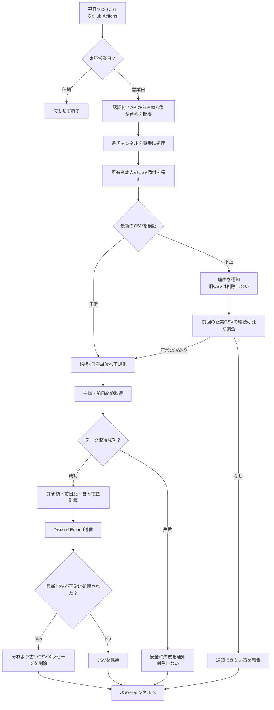

# 日次処理フローとCSVルール

[← Home](Home.md) ｜ [セキュリティ](Security-Design.md)

## 定期実行の全体像

> 図の「前回の正常CSV探索」は要件を満たすための**実装案**で、探索範囲・例外処理は未決です。旧CSV削除の正確なタイミングも、投稿成功・再試行時の重複を考慮して確定します。

## CSV取り込みの決定事項

1. チャンネルIDに登録された**持ち主本人のユーザーID**からの投稿だけを対象とする。
2. 最新のCSV添付を採用。CSV以外の添付や通常の会話は無視。
3. 1メッセージにCSVが2個以上あれば不採用にし、「1つにしてください」と通知。
4. 楽天証券・SBI証券のCSVを**利用者に加工させずそのまま**受け取る。内容から証券会社を判定。
5. 持ち株の1行は **銘柄 × 口座種別（NISA、特定など）** 単位。
6. パース失敗時は、列不足などの理由を通知して**一切削除しない**。
7. 正常に読めたときだけ、それより古いCSVの**メッセージ全体**を削除。通知メッセージは残す。
8. 更新の反映は次のActions実行時。添付直後の応答は初期段階では行わない。

**未決：** 実CSVの列名・文字コード・前置行、CSV内の個人情報、日本株以外の資産の扱い。実物の匿名化サンプルを確認するまでパーサーの仕様を確定しません。

## 通知フォーマット

- Embedの色：全体の含み損益がプラスなら緑、マイナスなら赤（ゼロの扱いは未決）。
- タイトル例：`📊 11/10（月）引け後の持ち株`
- 合計評価額、前日比の金額と率、含み損益の金額と率、銘柄別の前日比・評価額を表示。
- 前日比は株価取得時に前日の終値も取得して計算し、日次の自前データベースは持たない。
- 通知メッセージは削除せず履歴として残す。
- Discord Embedのサイズ制限、分割投稿、株価未取得銘柄の表示は実装時に決定。

## 価格計算で確認する事項

保有数量・取得単価・時価の単位を統一し、分割・売買・通貨・投資信託等の例外を扱います。株価APIの取得時刻や「前日終値」が**直前の取引日**を指すことを検証します。価格が取得できないときは誤ったゼロ円評価を出さないようにします。

## テスト項目

- 投稿者が本人でない／CSVがない／CSV複数添付
- 文字コード、欠損列、未知の証券会社、同銘柄の異なる口座
- 最新CSVが不正、古い正常CSVがある／ない
- Discord APIの権限不足、レート制限、投稿失敗、削除失敗
- 休日、祝日、年末年始、価格欠損、通知再実行による重複
