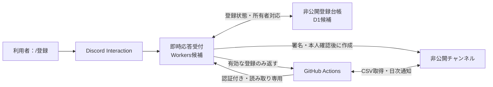

# 利用者自身による `/登録`

[← Home](Home.md) ｜ [セキュリティ](Security-Design.md)

> **状態：利用者操作は決定済み。コード・サービスは未実装。** 即時応答基盤と非公開の登録台帳を初期リリースに追加する。Cloudflare Workers + D1は構成案であり、無料枠・カード登録不要の条件と動作検証後に採否を確定する。

## 利用者の操作

1. 導入済みのDiscordサーバーで、引数なしの `/登録` を実行する。
2. Botから本人だけに「専用チャンネルを作成しました」とリンクが返る。
3. 専用チャンネルの案内に従い、楽天証券またはSBI証券のCSVを1ファイル添付する。

証券会社、チャンネル名、権限、ユーザーIDの入力は求めない。証券会社はCSVの内容から判定する。登録済みの場合は既存チャンネルを案内し、繰り返し実行しても増やさない。CSVの更新反映と通知は次の日次処理で行う。

## 自動設定する内容

- 許可されたサーバーの指定カテゴリー内に、個人情報を含まない識別用の名前で専用チャンネルを作成する。
- 作成リクエストの時点から非公開の権限を指定し、公開状態で作ってから隠す手順を使わない。
- `@everyone` の閲覧を拒否し、本人に閲覧・履歴・送信・添付、Botに処理に必要な権限を付与する。初期状態で共有相手を追加しない。管理者等によるアクセスの制約は案内する。
- 既存の方針に従い、本人が共有範囲を変更できる権限はテストサーバーで実効性と影響を確認してから採用する。カテゴリーとの権限同期は行わない。
- サーバーID・本人ID・チャンネルID・登録状態を非公開の登録台帳へ保存する。表示名、証券口座情報、CSV、銘柄や金額は台帳に保存しない。
- CSVは単独メッセージに1ファイル添付すること、管理者等の閲覧可能性、更新時期を専用チャンネルで案内する。

## 構成案と日次処理への連携

日次処理は認証付きAPIで台帳を読み、投稿者IDと所有者IDを照合する。台帳の取得に失敗したら処理を止め、チャンネル名や権限から所有者を推測しない。レスポンスはキャッシュせず、本文・ID・認証ヘッダーをログや成果物に出さない。

これまでの `CHANNEL_OWNERS` の手動更新は、自動更新される非公開台帳へ置き換える。Actionsと即時応答基盤で別々の対応表を持たず、同じ台帳を参照する。SecretsにはBotトークンと台帳読み取りAPIの認証情報などを置く。サービスの管理用APIトークンを日次処理へ渡さない。

CSV本体と通知履歴は引き続きDiscordに保存する。日次の株価・保有資産DBは導入しない。追加するDBは登録管理だけに使う。

## 受付・重複・失敗の扱い

- Discordの署名とタイムスタンプを検証し、許可サーバー内の実行だけを受け付ける。所有者は検証済みInteractionの実行者から決め、任意の本人IDを指定させない。
- 3秒以内に本人だけに見えるDeferred応答を返し、処理結果をInteractionトークンの有効期間内に返す。HTTPリクエスト受信後のバックグラウンド処理の継続方法と制限は実装時に検証する。
- サーバーと本人の組み合わせを一意にし、Interactionの再送と同時実行を考慮して、作成権を確保した処理だけがチャンネルを作る。
- `作成中` と `有効` を区別する。チャンネル作成後に権限と台帳の保存を確認してから有効にし、日次処理の対象にする。
- Discordと台帳の更新は同一トランザクションにできない。作成結果が不明なタイムアウトや保存失敗では、自動で追加作成しない。非公開のまま処理を保留し、照合・復旧の手順を設ける。
- 既存チャンネルが削除済み・アクセス不能の場合は、状態を確認してから復旧する。権限を外されたチャンネルを無条件に復活させない。
- 連打の制限とサーバー全体の登録数上限を設ける。エラー応答・運用ログへ実IDや秘密の値を含めない。

## 管理者が初回だけ行う準備

1. Botと `/登録` コマンドを対象サーバーへ導入する。
2. 対象サーバーとカテゴリーを非公開設定へ登録し、必要なチャンネル作成・権限設定の権限をBotへ付与する。Administratorは付与しない。
3. 即時応答受付・登録台帳・Secretsを設定し、日次処理の読み取り権限を接続する。
4. 別の一般利用者アカウントで、他人のチャンネルが見えないことと、連打・同時実行・失敗時の挙動をテストする。

利用者追加のたびにGitHub設定を編集する作業は不要にする。実際のID・URL・認証情報を公開リポジトリやWikiへ記録しない。

## 導入前の確認事項

- Workers + D1の無料プラン、カード要否、超過時の挙動、署名検証とバックグラウンド処理の制限。
- 台帳のアクセス制御、認証情報の失効・再発行、登録解除とデータ削除の運用。
- Botのロール階層、既存ロールの許可との競合、本人へ共有権限を付与した場合の影響。
- 正常登録、再登録、同時実行、署名不正、対象外サーバー、権限不足、台帳障害、Discordタイムアウトのテスト。

公式資料：[Discordの応答仕様](https://github.com/discord/discord-api-docs/blob/main/developers/interactions/receiving-and-responding.mdx)、[チャンネル作成](https://github.com/discord/discord-api-docs/blob/main/developers/resources/guild.mdx)、[権限](https://github.com/discord/discord-api-docs/blob/main/developers/topics/permissions.mdx)。候補サービス：[Workersの料金](https://developers.cloudflare.com/workers/platform/pricing/)、[D1の料金](https://developers.cloudflare.com/d1/platform/pricing/)。
