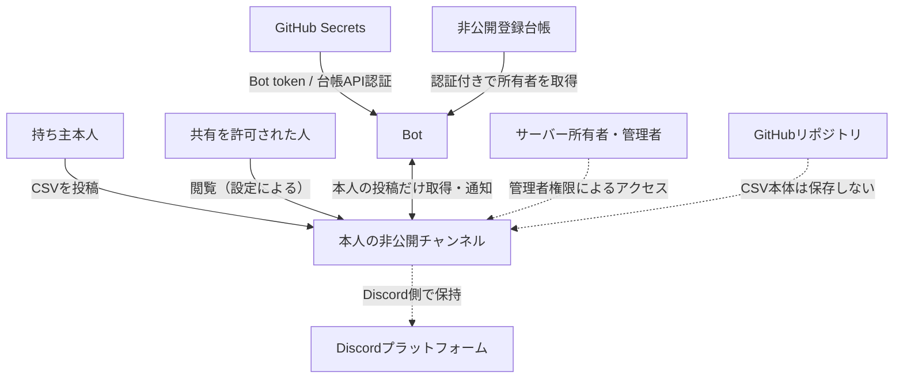

# セキュリティ・権限・プライバシー

[← Home](Home.md) ｜ [処理フロー](Processing-Flow.md)

## 公開範囲と最重要ルール

GitHubリポジトリとWikiは公開する。Discordの利用者別チャンネルは引き続き非公開とし、GitHubの公開と区別する。

個人情報・認証情報・保有資産情報・実際のチャンネルと所有者の対応表を、Git履歴、Wiki、Issue、PR、Actionsログ・成果物を含む公開コンテンツへ一切反映しない。認証情報は専用のSecrets、対応表はアクセス制御された非公開登録台帳に保管し、値を出力しない。誤反映やその疑いを検知したら、削除だけで解決したとせず直ちに利用者へ報告する。詳細はリポジトリ直下の `AGENTS.md` に従う。

公開リポジトリのActionsログは公開される前提で扱う。外部からのPRのコードを、実運用のSecretsを持つ処理で実行しない。

## データと権限の境界

## チャンネル権限の目安

カテゴリー「ポートフォリオ共有」の下に利用者ごとのチャンネルを設置し、`@everyone` の「チャンネルを見る」を拒否します。カテゴリーと権限は**同期しません**。

| 権限 | 持ち主本人 | 共有された人（推奨） | Bot |
| --- | --- | --- | --- |
| チャンネルを見る | 許可 | 許可 | 許可 |
| メッセージ履歴を読む | 許可 | 許可 | 許可 |
| メッセージを送信 | 許可 | 拒否 | 許可 |
| ファイルを添付 | 許可 | 拒否 | 許可 |
| メッセージの管理 | 原則不要 | 拒否 | 許可 |
| 権限の管理 | 許可（要検証） | 拒否 | 原則不要 |
| チャンネルの管理 | 拒否 | 拒否 | 原則不要 |
| スレッド作成・送信 | 任意 | 拒否推奨 | 必要に応じて |

**注意：** 持ち主が「権限の管理」を持つとBotの閲覧権限を外せる可能性があります。Discordの実際の権限判定とロール階層をテストチャンネルで検証します。共有相手の権限は持ち主が変えられるため、表は強制保証ではありません。**アプリ側で投稿者IDを照合することが必須**です。

## Secretsとログ

| Secret名（案） | 用途 |
| --- | --- |
| `DISCORD_BOT_TOKEN` | Discord Botの認証 |
| `REGISTRY_API_URL` / `REGISTRY_READ_TOKEN` | 非公開登録台帳APIの接続先・読み取り専用認証（名称案） |

- GitHub Actions Secretsは認証情報・非公開接続設定のみ。所有者の対応は非公開登録台帳へ保存する。**保有株CSV本体を保存しない**。
- ログ・例外・テストレポートにCSV内容、保有銘柄、株数、評価額、口座番号を出さない。
- `.env`、Codexの認証情報、BotトークンをGitにコミットしない。
- BotにAdministratorを与えない。登録受付に必要なチャンネル作成・権限設定の権限を追加し、ロール階層と付与範囲を検証する。
- Message Content IntentはDiscord Developer PortalでONにする方針（REST APIで他人の添付を読むため）。実際の必要条件は最新仕様で確認する。

## CSVの削除と個人情報

- 新CSVが読めた場合だけ古いCSVの**投稿メッセージ**を削除します。投稿文も消え、復旧できません。
- **最新CSVに氏名や口座番号が含まれるかは未確認。** 共有閲覧者に見える可能性があるため、実CSVの確認が必要です。
- 対策候補：Botが銘柄・数量・取得単価等だけの最小化CSVを投稿し直し、元CSVを削除する。ただし処理前に元CSVが閲覧可能になる点、Botの投稿を次回どのように認識するかは別途設計が必要。
- Discordのメッセージはエンドツーエンド暗号化された個人用金庫ではありません。Discord運営側のアクセス可能性があります。
- サーバー所有者や管理者権限の利用者は非公開チャンネルにアクセスできます。管理者ロールを安易に付与しません。
- 各利用者は元CSVを自分の端末にも保管します。

## 新規利用者の登録

利用者自身がDiscordで `/登録` を実行します。非公開チャンネルの作成・基本権限設定・本人との対応登録・CSV投稿案内を自動化します。登録済みなら既存チャンネルを本人だけに案内し、重複作成しません。

管理者が利用者ごとにチャンネルを作り、`CHANNEL_OWNERS` を編集する旧手順は廃止する設計です。Bot導入・カテゴリー・受付サービス・Secretsの準備は初回だけ管理者が行います。詳細と失敗時の扱いは [登録設計](Registration-Design.md) を参照してください。

## 運用上の注意

Botをチャンネルから外すと通知は止まります。CSVは単独メッセージで添付し、同じ投稿に説明文を書かないよう利用者へ案内します。
