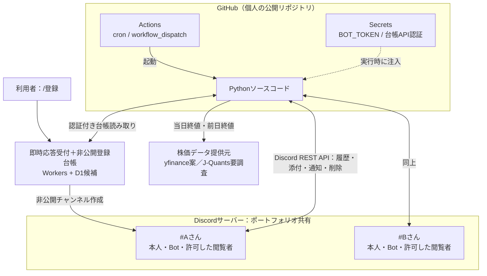
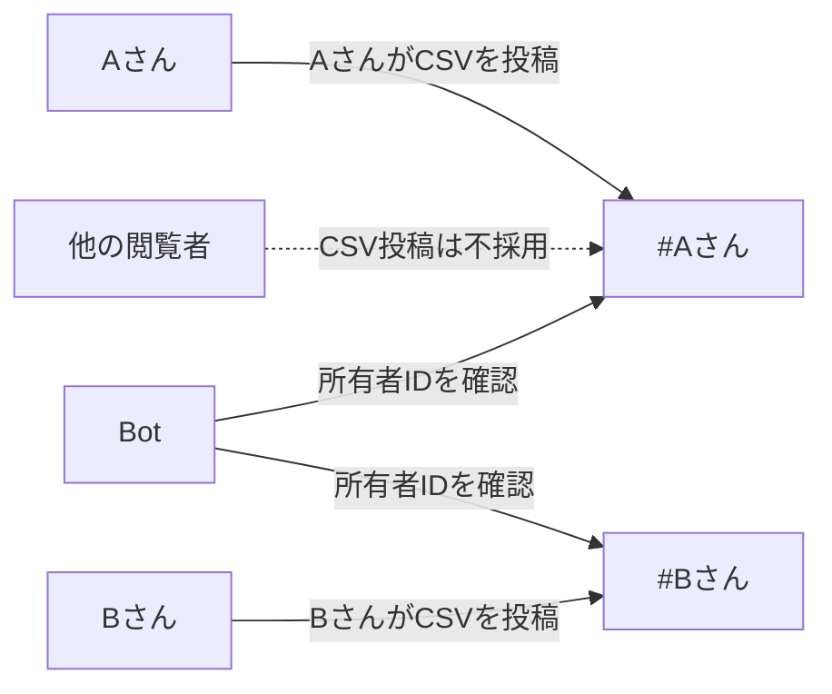

# システム構成

[← Home](Home.md) ｜ [処理フロー](Processing-Flow.md)

## 本番構成（決定済みの基本方針）

- 常時稼働Botや独立したサーバーは用いません。`/登録` 用に即時応答受付と非公開登録台帳を追加します（[登録設計](Registration-Design.md)）。登録台帳以外のDBは導入しません。
- 日次処理はActionsの実行中にBotトークンを使って履歴を参照します。登録受付もチャンネル作成用のBot認証を使用し、Secretsで保管します。
- チャンネルと所有者の対応は非公開登録台帳を認証付きで取得し、**メッセージ投稿者IDと照合**します。
- CSV本体はDiscordの添付として保持し、GitHubのリポジトリやActionsのログには保存しません。
- 株価提供元は未決です。無料の非公式データ取得（yfinance）は停止・遅延・利用条件変更のリスクがあります。

## チャンネルとCSVの関係

### 論理コンポーネント（実装案）

| コンポーネント | 責務 |
| --- | --- |
| Discord APIクライアント | メッセージ一覧・添付取得・Embed送信・古いCSV削除 |
| 登録受付・台帳 | `/登録` の検証、非公開チャンネル作成、所有者の自動登録 |
| チャンネル処理 | 非公開台帳の検証、投稿者の照合 |
| CSVパーサー | 証券会社判定、形式検証、銘柄×口座単位への変換 |
| 株価取得 | 株価・前日終値の取得、欠損・失敗の扱い |
| 評価・集計 | 評価額、前日比、含み損益の計算 |
| 通知生成 | チャンネルごとのEmbed生成、文字数制限への対応 |
| 実行制御 | 取引日判定、DRY_RUN、ログの秘匿 |

## 初期段階で採用しないもの

- Webhookのみの通知（CSVを読めない）。
- 常時起動するRender / Heroku / Fly.io / Railway等のサーバー。
- カード登録が必要なクラウドサービス。
- 保有資産・CSV・日次株価を保存する外部DB（非公開の登録台帳のみ例外）。
- CSVをGitHubにコミットする運用、またはCSV本体をGitHub Secretsへ保存する運用。

## 重要な設計上の論点

最新CSVが不正な場合「前のCSVで通知を続ける」には、**過去の正常CSVを探索して再検証する処理**などが必要です。どこまで遡るか、失敗を何度通知するかは実装時に確定します。Discord添付の可用性にも依存します。
